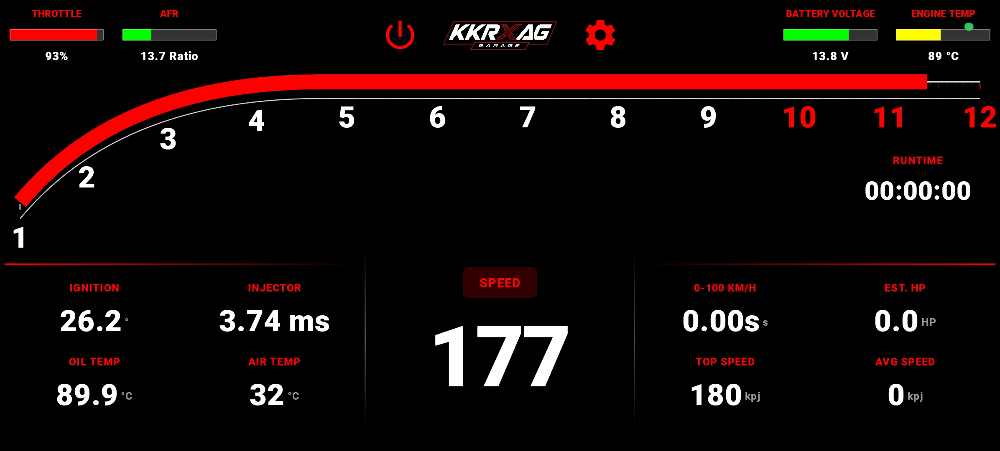
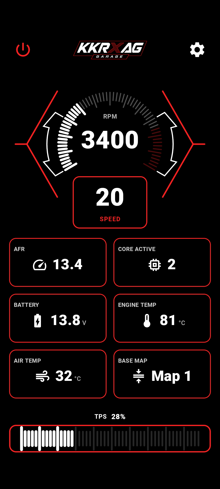
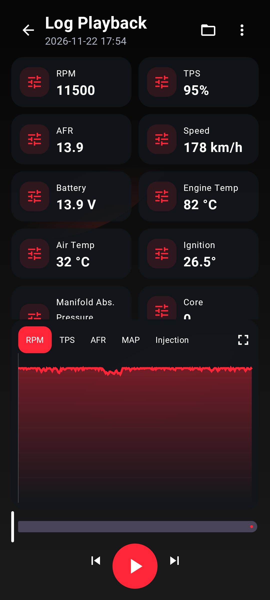
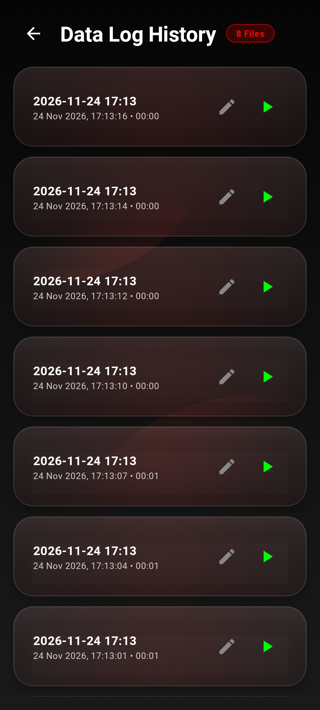

<h1 align="center">Juken 5 Live Monitor</h1>

# ✨ Features

- 📡 Bluetooth connection to BRT Juken 5 ECU
- 📊 Real-time engine monitoring
- 🌡️ Engine temperature
- 🔥 RPM Monitoring
- ⚡ Battery Voltage
- 💨 TPS (Throttle Position Sensor)
- 💉 Injector Pulse Width
- 🌀 Ignition Timing
- 📈 Smooth animated dashboard
- 🌙 Modern Dark UI

---

## 📋 Update V0.4.0

- Support New Bluetooth Connection
- Support Android Auto Self Mode
- Add 2 New Themes
- Add Record Log
- Overheat Warning
- Auto Reconnect ECU
- Fix Some Bugs

---

## 📱 Screenshots

### Landscape

<p align="center">
  
  
  
  
</p>
<p align="center">
  
  
</p>

### Portrait

<p align="center">
  
  
  
  
</p>
<p align="center">
  
  
</p>

---

## 🛠 Tech Stack

- Kotlin
- Android SDK
- Material Design 3
- Bluetooth Classic

---

## 📥 Installation

Clone this repository

```bash
git clone https://github.com/surya-kkr/Juken5LiveMonitor.git
```

Open using Android Studio.

Run the project on Android 8.0+.

## 📦 Download APK

[⬇️ Download Juken5LiveMonitor V0.4.0 APK](https://github.com/surya-kkr/Juken5LiveMonitor/releases/download/v0.4.0/Juken5LiveMonitor.V0.4.0.apk)

---

## 📖 Tutorial Penggunaan (Bahasa Indonesia)

### Menghubungkan ECU Juken 5

1. Setujui semua permission yang diminta oleh aplikasi.
2. Buka pengaturan Bluetooth di HP, lalu pair ECU terlebih dahulu. Masukkan PIN Bluetooth jika diminta.
3. Buka kembali aplikasi Juken 5 Live Monitor.
4. Cari dan pilih nama Bluetooth ECU Juken 5 Anda di dalam aplikasi.
5. Tunggu sampai proses inisialisasi selesai sebelum menggunakan aplikasi.
6. Fitur Android Auto tersedia dalam mode landscape.

### Mengaktifkan Android Auto Self Mode

1. Buka **Settings/Pengaturan** di HP.
2. Pilih **More connectivity options/Opsi konektivitas lainnya**.
3. Pilih **Android Auto**.
4. Scroll ke bagian paling bawah, lalu ketuk **Version** beberapa kali sampai **Developer settings** muncul.
5. Ketuk menu tiga titik di pojok kanan atas, lalu pilih **Start head unit server**.
6. Kembali ke aplikasi Juken 5 Live Monitor.
7. Sesuaikan ukuran DPI Android Auto melalui pengaturan di dalam aplikasi.

---

## 📖 User Guide (English)

### Connecting the Juken 5 ECU

1. Grant all permissions requested by the app.
2. Open your phone's Bluetooth settings and pair the ECU first. Enter the Bluetooth PIN if requested.
3. Open the Juken 5 Live Monitor app again.
4. Find and select your Juken 5 ECU Bluetooth device in the app.
5. Wait until the initialization process is complete before using the app.
6. Android Auto features are available in landscape mode.

### Enabling Android Auto Self Mode

1. Open **Settings** on your phone.
2. Select **More connectivity options**.
3. Select **Android Auto**.
4. Scroll to the bottom and tap **Version** several times until **Developer settings** appears.
5. Tap the three-dot menu in the top-right corner, then select **Start head unit server**.
6. Return to the Juken 5 Live Monitor app.
7. Adjust the Android Auto DPI using the app's settings.

---

## 🚧 Roadmap

- [x] Bluetooth Connection
- [x] Live Dashboard
- [x] Data Logging
- [ ] Export CSV
- [x] Graph View
- [x] Dark Theme
- [ ] ECU Configuration

---

## 📄 License

This project is intended for educational and personal use.

---

## 👨‍💻 Developer

**Keniah KKR**

GitHub:
https://github.com/surya-kkr
"# Juken5LiveMonitor-V.0.1.5" 
