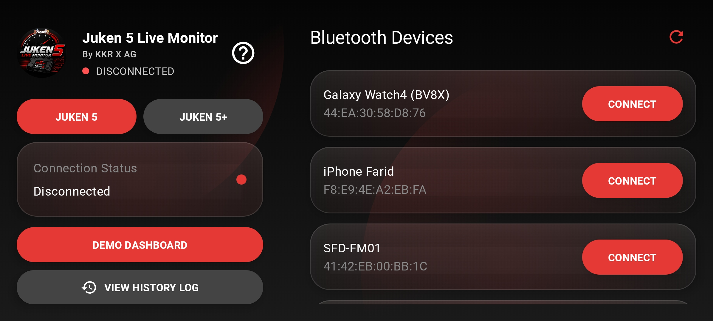
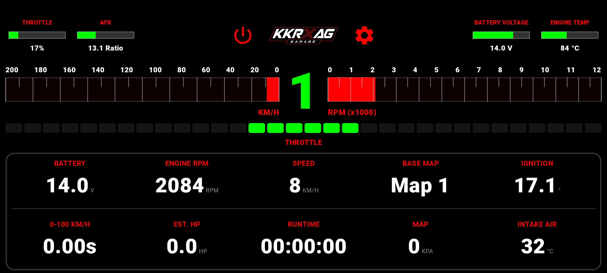
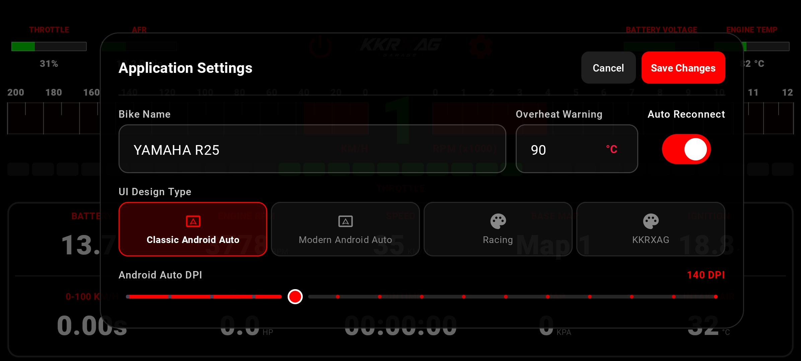
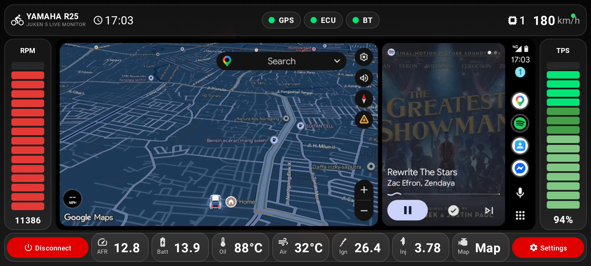
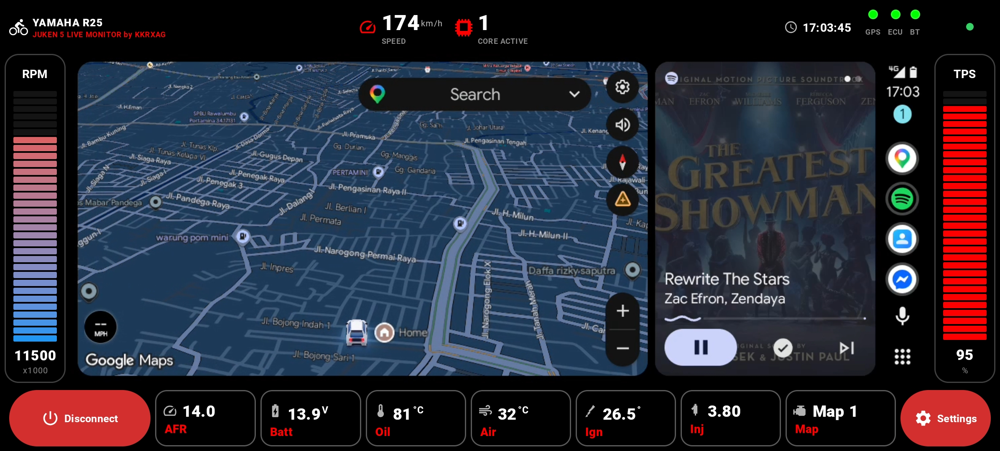
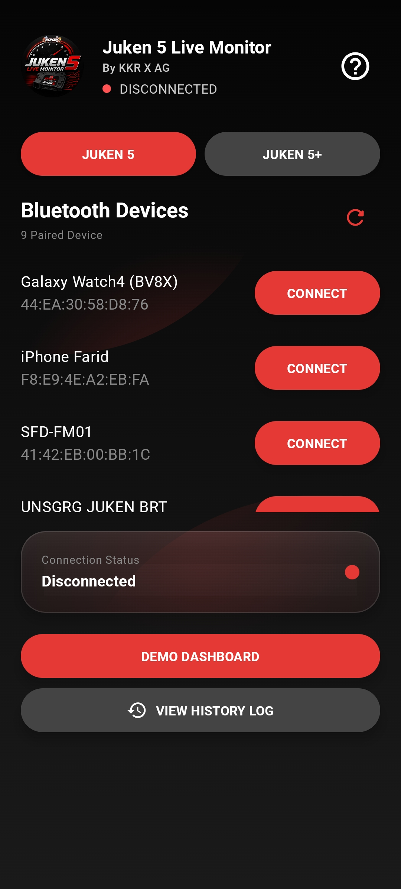
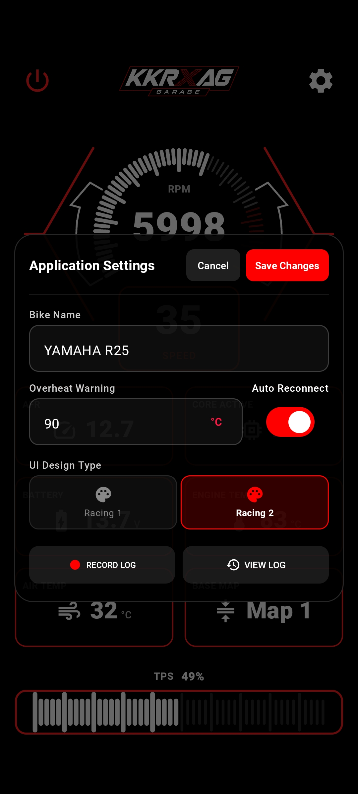
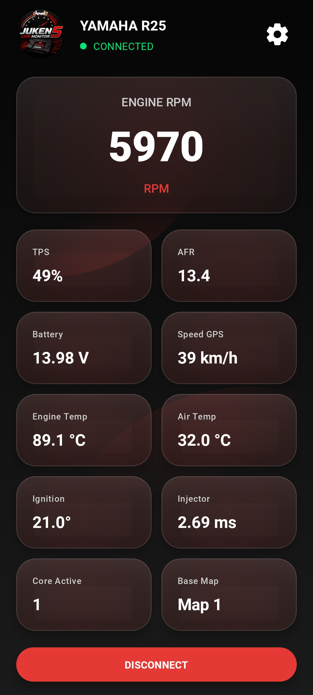

<h1 align="center">Juken 5 Live Monitor</h1>

# ✨ Features

- 📡 Bluetooth connection to BRT Juken 5 ECU
- 📊 Real-time engine monitoring
- 🌡️ Engine temperature
- 🔥 RPM Monitoring
- ⚡ Battery Voltage
- 💨 TPS (Throttle Position Sensor)
- 💉 Injector Pulse Width
- 🌀 Ignition Timing
- 📈 Smooth animated dashboard
- 🌙 Modern Dark UI

---

## 📋 Update V0.4.0

- Support New Bluetooth Connection
- Support Android Auto Self Mode
- Add 2 New Themes
- Add Record Log
- Overheat Warning
- Auto Reconnect ECU
- Fix Some Bugs

---

## 📱 Screenshots

### Landscape

<p align="center">
  
  
  
  
</p>
<p align="center">
  
  
</p>

### Portrait

<p align="center">
  
  
  
  
</p>
<p align="center">
  
  
</p>

---

## 🛠 Tech Stack

- Kotlin
- Android SDK
- Material Design 3
- Bluetooth Classic

---

## 📥 Installation

Clone this repository

```bash
git clone https://github.com/surya-kkr/Juken5LiveMonitor.git
```

Open using Android Studio.

Run the project on Android 8.0+.

## 📦 Download APK

[⬇️ Download Juken5LiveMonitor V0.4.0 APK](https://github.com/surya-kkr/Juken5LiveMonitor/releases/download/v0.4.0/Juken5LiveMonitor.V0.4.0.apk)

---

## 🚧 Roadmap

- [x] Bluetooth Connection
- [x] Live Dashboard
- [x] Data Logging
- [ ] Export CSV
- [x] Graph View
- [x] Dark Theme
- [ ] ECU Configuration

---

## 📄 License

This project is intended for educational and personal use.

---

## 👨‍💻 Developer

**Keniah KKR**

GitHub:
https://github.com/surya-kkr
"# Juken5LiveMonitor-V.0.1.5" 
